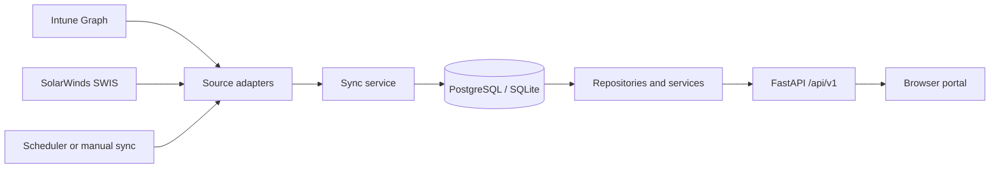

# ITOM Portal

ITOM Portal collects infrastructure and endpoint telemetry from Microsoft Intune and SolarWinds Orion, reconciles it into a database-backed configuration management database (CMDB), and presents the inventory and operational summaries in a browser portal and read-oriented REST API. Collection runs in the backend scheduler; opening the UI reads the stored snapshot and does not itself refresh a source.

## Quick start

### Local development

Requires Python 3.11 or later (the project dependencies and container image target Python 3.11). Create a virtual environment, install dependencies, and configure `.env` from `.env.example`:

```powershell
python -m venv .venv
.venv\Scripts\Activate.ps1
pip install -r requirements.txt
Copy-Item .env.example .env
```

Set source credentials in `.env` before expecting live ingestion. For API-only work, set `SCHEDULER_ENABLED=false` to prevent periodic source calls. Configure `DATABASE_URL` for PostgreSQL or a local SQLite database, then run:

```powershell
python -m uvicorn app.main:app --host 127.0.0.1 --port 8080
```

The API documentation is at [http://127.0.0.1:8080/docs](http://127.0.0.1:8080/docs). Check liveness at `/healthz`, database readiness at `/ready`, and source freshness at `/api/v1/system/freshness`.

Open `http://127.0.0.1:8080/` for the portal. FastAPI serves `frontend/` and the API on the same origin; a separate static server is unnecessary. Apply `alembic upgrade head` before expecting `/ready` to report migration readiness.

The frontend API client supports `window.ITOM_API_BASE` when a separately hosted UI needs another API origin. See [deployment](docs/DEPLOYMENT.md) for supported local supervisor and container setups.

### Docker Compose

With Docker Compose installed, start PostgreSQL, the API, and NGINX:

```bash
docker compose up --build -d
```

Open `http://localhost:8080`. Compose exposes the portal through NGINX, which serves `frontend/` and proxies `/api/` to the internal FastAPI service. Configure secrets and source settings through the deployment environment before using live sync; see [.env.example](.env.example) and [deployment](docs/DEPLOYMENT.md).

## What the application contains

- **Portal:** zero-build HTML, CSS, and JavaScript modules in `frontend/`, including summary views, infrastructure analytics, inventory tables, and sync status.
- **API:** FastAPI endpoints under `/api/v1` for CMDB, Intune, SolarWinds, analytics, freshness, and sync history.
- **Ingestion:** APScheduler invokes the sync service on `SYNC_INTERVAL_SECONDS` (default 600 seconds). Intune Graph and SolarWinds SWIS adapters normalize source records before persistence.
- **Persistence:** asynchronous SQLAlchemy models and repositories; PostgreSQL is the production target, with SQLite support for local development and tests. Alembic migrations are under `alembic/`.
- **Operational history:** source-specific sync runs, errors, and status/health transitions are stored for freshness and audit views.



## Important data behavior

- A domain with no ingested records may return **503**. The API does not manufacture empty-looking KPI values.
- Freshness is a response body state (`FRESH`, `STALE`, or `UNKNOWN`). Check it separately from process health before presenting metrics.
- Location analytics are limited by source coverage. Intune does not provide the site attribute used for SolarWinds location reporting; inspect the API's location coverage fields.
- Assets absent from a validated complete source snapshot can be marked inactive and retained for audit. Failed or partial extraction must not be treated as authority to retire assets.
- Inventory APIs are read-only. Sync operations are separate endpoints and can trigger external source calls; protect them appropriately when exposing the service.

## Common commands

| Purpose | Command |
| --- | --- |
| Start API | `python -m uvicorn app.main:app --host 127.0.0.1 --port 8080` |
| Install test dependencies | `python -m pip install -r requirements-test.txt` |
| Run offline test suite | `python -m pytest tests/ -q -ra` |
| Apply migrations | `alembic upgrade head` |
| Start container stack | `docker compose up --build -d` |
| Stop container stack | `docker compose down` |
| Check source connectivity | `python scripts/check_live_connectivity.py` |
| Run a source sync | `python scripts/run_live_sync.py --source solarwinds` or `--source intune` |

Use the commands above according to the configured environment. Live connectivity and sync commands require valid credentials and contact configured external systems.

## Repository map

| Path | Purpose |
| --- | --- |
| `frontend/` | Current browser application and static assets |
| `app/api/v1/endpoints/` | Versioned HTTP routes |
| `app/services/` | Sync orchestration and application logic |
| `app/repositories/` | Database reads and aggregates |
| `app/models/`, `app/schemas/` | Persistence models and API serialization |
| `src/sync/` | Intune Graph and SolarWinds clients |
| `alembic/` | Database migrations |
| `scripts/` | Operations, local startup, and connectivity utilities |
| `tests/` | Unit and integration checks |
| `docs/` | Architecture, data flow, deployment, API, and onboarding guides |

## Further documentation

- [Architecture](docs/ARCHITECTURE.md) — runtime components, request flow, synchronization, and data model.
- [API contracts](docs/API_CONTRACTS.md) — endpoint contract details.
- [Data flow](docs/DATA_FLOW.md) — source-to-database processing.
- [Deployment](docs/DEPLOYMENT.md) — container and local service operation.
- [Testing](tests/README.md) — isolated test commands, requirement coverage and known defects.
- [Onboarding](docs/ONBOARDING.md) — codebase orientation and developer workflow.
- [Troubleshooting](docs/TROUBLESHOOTING.md) — common operational failures.
- [Project context](docs/PROJECT_CONTEXT.md) — product scope and implementation context.

## Security and deployment

Keep `.env` out of version control and use unique credentials and a strong `SECRET_KEY` outside development. Restrict network access and configure explicit CORS origins when deploying. The sync trigger can initiate external API calls, so do not expose it to untrusted clients without access controls. Review the current security and operational requirements in [deployment](docs/DEPLOYMENT.md) before placing the service on a shared network.

Historical prototype specifications and implementation reports are retained under [docs/archive](docs/archive/legacy-2026-09/README.md). Current cleanup details are in [the cleanup report](docs/cleanup-reports/CODE_CLEANUP_2026-10-08.md).
