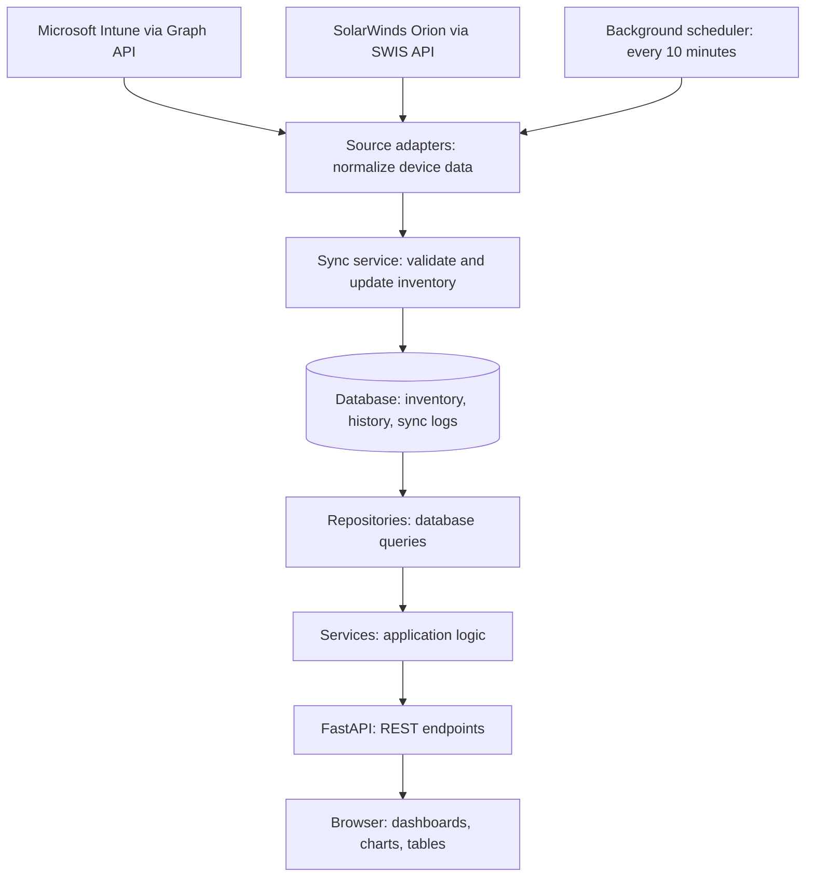
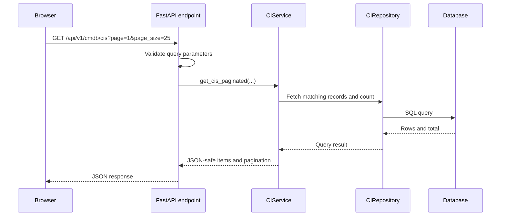

# ITOM Portal Architecture

The ITOM portal collects Microsoft Intune and SolarWinds telemetry, stores a common inventory, and serves dashboards through a database-backed REST API. This guide follows the current implementation rather than historical snapshots or prototype pages.

## Architecture diagram

There are two independent flows: scheduled collection updates the database, and browser requests read its latest stored snapshot. Opening a dashboard does not trigger a new source extraction. The default collection interval is 600 seconds, configurable through `SYNC_INTERVAL_SECONDS`.

## Frontend

The deployed frontend is `frontend/`, served directly without a bundler. It uses HTML, CSS, JavaScript ES modules, and Chart.js.

| Entry point | Responsibility |
| --- | --- |
| `frontend/index.html` | Workspace containers and page structure |
| `frontend/js/app.js` | Startup and navigation |
| `frontend/js/components/` | Overview, infrastructure, endpoints, CMDB, and sync views |
| `frontend/js/api.js` | Shared FastAPI client |
| `frontend/css/style.css` | Current portal styling |

The API client uses `/api/v1` on the current origin. `window.ITOM_API_BASE` can override this selection. Failed requests propagate errors instead of silently substituting static JSON.

## Backend request flow

| Layer | Location | Responsibility |
| --- | --- | --- |
| Application | `app/main.py` | Lifespan, scheduler startup, middleware, route registration |
| Routes | `app/api/v1/endpoints/` | HTTP input validation and endpoint routing |
| Services | `app/services/` | Application logic, ingestion, response coordination |
| Repositories | `app/repositories/` | SQLAlchemy database queries and aggregates |
| Models | `app/models/` | Persistent table definitions |
| Schemas | `app/schemas/` | Response structures and JSON serialization |
| Core | `app/core/` | Configuration, database sessions, middleware, security helpers |

Summary values are computed from the database. An unavailable dataset can return HTTP 503. Inventory routes reject write methods; the separate sync trigger can start ingestion into the portal's own database.

## Collection and reconciliation

1. `app/workers/scheduler.py` invokes `SyncService` on the configured interval.
2. Source adapters in `app/services/telemetry_sources.py` call the clients in `src/sync/graph_client.py` and `src/sync/solarwinds_client.py`.
3. The adapters normalize different source fields into common configuration-item dictionaries and validate snapshot identities.
4. `app/services/sync_service.py` inserts or updates current inventory. PostgreSQL uses a transaction-scoped advisory lock to prevent overlapping sync execution; the non-PostgreSQL fallback lock is process-local.
5. A SHA-256 fingerprint of status and health tier controls transition-history writes. CPU or RAM changes alone do not create a new status-history row.
6. A validated complete source snapshot can retire missing assets by marking them inactive. Failed or incomplete extraction must not authorize retirement.
7. Each source has its own sync audit record, so one source succeeding cannot make another source appear fresh.

The normal scheduler fetches live source data directly. `FixtureSource` is an explicit offline/test adapter, not the default ingestion path or an automatic outage fallback.

## Database

CMDB means Configuration Management Database. A configuration item (CI) is a tracked asset such as a laptop, server, or switch.

| Table | Purpose |
| --- | --- |
| `configuration_items` | Current inventory, source identity, status, health, attributes, and retirement state |
| `ci_relationships` | Relationships between assets |
| `ci_status_history` | Status/health transitions and reconciliation events |
| `sync_runs` | Per-source outcomes, timestamps, duration, and record counts |
| `sync_error_logs` | Sync failure details |

PostgreSQL 16 is the production database. SQLAlchemy provides asynchronous sessions and queries. Alembic migrations live in `alembic/`; production schema changes must be applied before startup. SQLite is supported for explicitly configured local and test databases; there is no automatic datastore fallback. Non-production startup can create missing tables.

History is change-oriented; it is not a complete sample of every performance measurement.

## Deployment

| Mode | Frontend | Backend | Persistence |
| --- | --- | --- | --- |
| Docker Compose | NGINX serves `frontend/`, normally exposed on port 8080 | Internal FastAPI port 8000; NGINX forwards `/api/` | PostgreSQL 16 |
| Local supervisor | FastAPI serves `frontend/` on port 8080 | Same Uvicorn listener serves the API | SQLite supported in local mode |

See `docker-compose.yml`, `nginx.conf`, and `scripts/local_itom_supervisor.py` for the actual wiring. Credentials and source connectivity are required for live extraction; the diagram does not imply that a running API has successfully synchronized.

## Freshness and reliability

`/api/v1/system/freshness` reports source data freshness. Middleware also adds freshness headers. A database may contain records while a source is unreachable, so availability and freshness must be shown separately. Failed extraction does not count as a successful refresh.

## Historical code

Root-level frontend copies, the file-based HTTP server and the Firestore snapshot runner were retired. Current portal code lives in `frontend/`; historical specifications and reports are under `docs/archive/legacy-2026-09/`. Standalone infrastructure and CMDB pages in `frontend/` remain available.

## Suggested reading order

Follow one feature: `frontend/js/components/endpoints.js` → `frontend/js/api.js` → `app/api/v1/endpoints/intune.py` → `app/services/ci_service.py` → `app/repositories/ci_repository.py`. Then read `app/services/telemetry_sources.py` and `app/services/sync_service.py` to learn how those records arrive.
