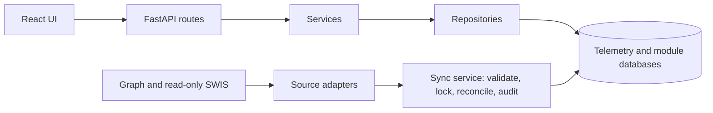

# Platform Execution Ledger

## Boundaries

Routes validate HTTP; services coordinate behavior; repositories own queries; adapters normalize source snapshots. A complete, unique identity set is required before retirement; failed and partial runs do not advance successful freshness. Do not infer live telemetry from empty experimental data.

## Local Experiment

- Production stays on loopback 8080. Experimental API is loopback 8081, with its own PostgreSQL listener on 55432 and separate `itom_experimental` and `itom_experimental_modules` databases.
- On Windows with PostgreSQL 18 tools and the existing Python dependencies, run `python scripts/provision_experimental.py` once from a clean checkout. It refuses existing data and generates independent credentials in ignored `data/experimental/`; it does not copy production data. Protect that directory with OS permissions. It is not a security boundary against the same OS user.
- Start with `scripts/start_staging_8081.ps1 -Python <python.exe>`. It rejects an occupied 8081 and checks the private experimental config against the production config before launching. The database cluster must be running; its data and log are under `data/experimental/`.
- Verify `/ready`, `/ready/modules`, and `/api/v1/sync/scheduler` on 8081. The scheduler must be off and `POST /api/v1/sync/trigger` must return 503. Freshness is `UNKNOWN` until isolated test data exists. This release excludes SSO and disables live connector credentials.
- To resume the cluster after a machine restart, use PostgreSQL `pg_ctl` with `-D data/experimental/postgres`, `-l data/experimental/postgres.log`, and `-o "-h 127.0.0.1 -p 55432"`. Do not run provisioning again over existing data.

## Developer Checks

- Run `python -m pytest tests/test_scheduler_and_locking.py tests/test_staging_configuration.py tests/test_api_contracts.py -q` and connector-specific tests with isolated fixtures and blocked external requests.
- Run `npm --prefix frontend-revamp test` and `npm --prefix frontend-revamp run build`; use the browser suite in `AGENTS.md` for UI changes.
- For a new connector, preserve stable source identity, define complete-snapshot evidence, implement read-only extraction and normalization, reject invalid/duplicate IDs, and test failure, partial, repeat, and retirement behavior. Never make SWIS mutations.

## Release Gate and Current Status

Production promotion requires the exact validated revision, mandatory tests, reviewed changes, independent database-aware backups, a tested rollback plan, and explicit owner approval. Restore source/config/static assets together if rolling back; do not assume an application rollback reverses a database migration. Branch protections and the authorized repository's PR process remain in force.

2026-11-27: The release branch was prepared from production revision `45f9745`, excluding the separate SSO work. Scheduler, sync gating, staging isolation, and connector changes passed 173 focused tests. Experimental data starts empty. Production has not yet been promoted: protected backup access, rollback readiness, review, and release checks require verification. An unrelated staged edit in the original worktree must remain untouched.